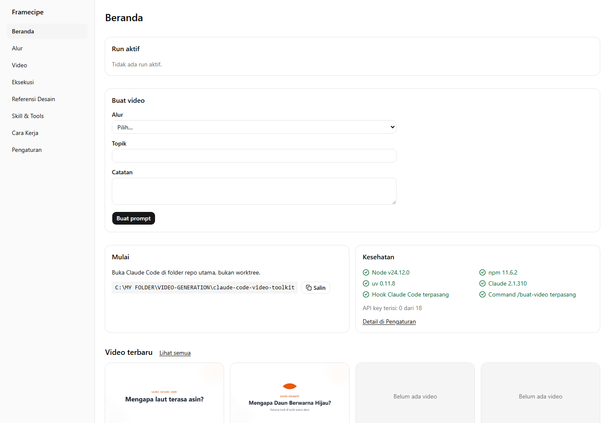
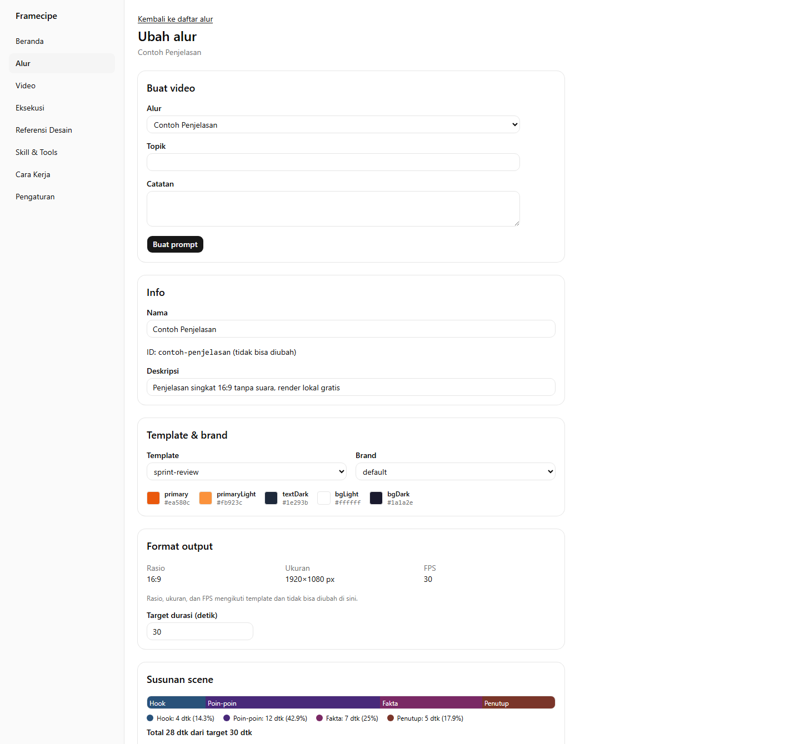
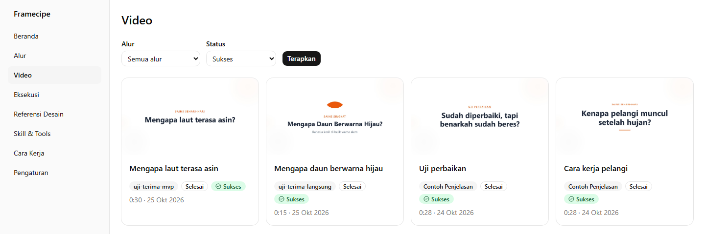
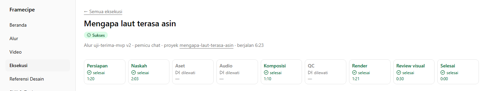
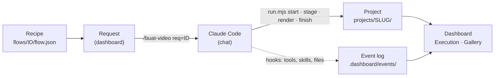

# Framecipe

**AI video editing and motion-graphics studio, driven by reusable recipes.**

Framecipe turns a written recipe into a finished video. You define the recipe once in a local dashboard: the template, brand, scene structure, style rules and design references. Then you ask [Claude Code](https://claude.com/claude-code) for a video on any topic. Claude writes the script, composes the scenes in [Remotion](https://www.remotion.dev/), renders the MP4, checks the frames, and files the result in your gallery. The dashboard shows every stage while it happens.




---

## Contents

- [Why Framecipe](#why-framecipe)
- [Features](#features)
- [How it works](#how-it-works)
- [Requirements](#requirements)
- [Getting started](#getting-started)
- [Making videos](#making-videos)
- [Dashboard tour](#dashboard-tour)
- [The production pipeline](#the-production-pipeline)
- [AI and motion-graphics toolkit](#ai-and-motion-graphics-toolkit)
- [Project layout](#project-layout)
- [Security and privacy](#security-and-privacy)
- [Troubleshooting](#troubleshooting)
- [Development](#development)
- [Roadmap](#roadmap)
- [Credits and license](#credits-and-license)

## Why Framecipe

Most AI video tools give you a different result every time you ask. Framecipe uses recipes so the output stays consistent.

- **A recipe is a repeatable production spec.** A recipe fixes the format, look and pacing of a video series. Every new topic follows the same structure: hook, explanation, facts, call to action, or whatever you design.
- **Claude Code does the production work.** It writes the script, edits the Remotion composition, renders, and reviews its own frames. It works inside guard rails that the recipe and the `/buat-video` command define.
- **Nothing is a black box.** Every stage, skill, command and changed file is recorded and shown live in the dashboard.
- **Rendering stays on your machine.** Remotion renders locally, and the video files, recipes and projects never leave your computer.

## Features

| | |
|---|---|
| **Recipe editor** | Pick a template and brand, set the target duration, and lay out scenes with goals, durations, rules, visual hints and transitions. Attach design references and skills, and choose between auto-run and script review before render. |
| **Requests** | Choose a recipe, enter a topic and notes, and get a ready-to-paste `/buat-video` prompt for Claude Code. |
| **Live execution view** | See the current stage, time spent per stage, the skills Claude loaded, the files it changed, the commands it ran, the render time and the review frames. Pages refresh every 2 seconds. |
| **Video gallery** | Browse every finished video with thumbnails taken from the review frames, filter by recipe or status, and play or download the MP4. |
| **Design references** | Look through the templates, brands (colors and logos), example projects, transitions and components that you can attach to a recipe. |
| **Skills and tools catalog** | See every Claude skill, command and Python tool in the workspace, how often each was used, when it was last used, and which recipes list it. |
| **Health and settings** | Check that Node, npm, uv and Claude Code are installed and that the hooks and command are in place. API keys are reported only as set or unset. Their values are never shown. |
| **Built-in safeguards** | Only one run is active at a time. A run with no activity for 15 minutes is detected as stalled. A video is only marked successful after its file is validated, so a failed render can never show up as a success. |

<table>
  <tr>
    <td width="50%"></td>
    <td width="50%"></td>
  </tr>
  <tr>
    <td align="center"><b>Recipe editor</b>: template, brand, format and scene timeline</td>
    <td align="center"><b>Gallery</b>: every finished video, filterable by recipe and status</td>
  </tr>
</table>



## How it works



1. **Recipe.** You create or edit a recipe in the dashboard. It is saved as `flows/<id>/flow.json`.
2. **Request.** On the home page you pick a recipe, enter a topic, and click **Buat prompt** ("create prompt"). The dashboard stores the request and gives you the prompt `/buat-video req=<id>`.
3. **Production.** You paste that prompt into Claude Code, opened at the repository root. Claude follows the `/buat-video` command step by step. It drives every stage through one helper, `dashboard/bin/run.mjs`, and edits files only inside `projects/<slug>/`.
4. **Observation.** Claude Code hooks (`dashboard/bin/hook.mjs`) record each tool call, skill load, file change and notification. The dashboard combines this log with the run's manifest to show live progress.
5. **Result.** `finish` validates the MP4 (it must exist, have a non-zero duration and valid dimensions), records it, and frees disk space. The video appears in the gallery.

The dashboard never starts Claude on its own. You start each video from the Claude Code chat, so you stay in control of every run.

## Requirements

| Requirement | Notes |
|---|---|
| **Node.js 20.9 or newer** | Developed and tested on Node 24. |
| **Claude Code** | Signed in with a Claude subscription. The production work uses your Claude usage quota. |
| **Chrome or Edge** | For viewing the dashboard. Rendering uses its own headless browser, downloaded once (about 270 MB) and shared by all projects. |
| **Disk space** | About 700 MB per project while it renders. Each project's `node_modules` is removed automatically after a successful run. |
| [uv](https://docs.astral.sh/uv/) *(optional)* | Only needed for the Python AI tools (voiceover, music, image and video generation). |
| FFmpeg *(optional)* | Only needed for some of the toolkit's utility tools. |

Framecipe is developed and tested on Windows 11, including paths that contain spaces. It is built on cross-platform tools.

## Getting started

### 1. Install and start the dashboard

```bash
cd dashboard
npm install
npm run dev
```

Open **http://127.0.0.1:3210**. For a production build, run `npm run build` and then `npm start`. It uses the same address.

### 2. Open Claude Code at the repository root

```bash
claude
```

Accept the **workspace trust** prompt when it appears. Framecipe registers its hooks, the `/buat-video` command and a narrow permission allowlist in `.claude/settings.json`, and Claude Code applies them only in a trusted workspace.

> Always run Claude Code from the main checkout, not from a git worktree. The run helper refuses to work inside a worktree.

### 3. Check the setup

On the home page, the **Kesehatan** (health) card should show green checks for Node, npm, Claude Code, the hooks and the `/buat-video` command.

### 4. Make your first video

1. On the home page, select the sample recipe **Contoh Penjelasan**, a 30-second 16:9 explainer.
2. Enter a topic, for example *Why is the sky blue?*, and click **Buat prompt**.
3. Copy the prompt and paste it into Claude Code.
4. Follow the run under **Eksekusi** (execution). The video appears under **Video** when it finishes.

## Making videos

### Ways to start a run

| Prompt in Claude Code | Use it when |
|---|---|
| `/buat-video req=<id>` | **Main flow.** Produces a request created in the dashboard. |
| `/buat-video <recipe-id> "<topic>"` | Starting directly from chat, without the dashboard form. |
| `/buat-video perbaiki=<runId>` | Resuming a failed, cancelled or stalled run from its existing project files (*perbaiki* means "fix"). The execution page shows this prompt for you. |

### What a recipe controls

| Field | Purpose |
|---|---|
| Template and brand | The Remotion template to build on and the brand that sets its colors, fonts and logo. |
| Output | The aspect ratio, resolution and frame rate come from the template. The target duration is yours to set. |
| Scenes | An ordered list of scenes. Each has a label, goal, duration, writing rules, a visual hint and an optional transition. |
| Style | Tone, audience, language and global writing rules. |
| References | Templates, examples, past projects, transitions, components, brands or links that Claude studies before it builds. |
| Skills | The Claude skills loaded for every run, for example `remotion-best-practices`. |
| Approval | `auto` runs straight through. `script-review` pauses after the script so you can approve it in chat. |
| Audio | Optional voiceover and music, which need the matching provider API key. The sample recipe is silent. |
| Notes | Free-form guidance that Claude follows on every run. |

### Run statuses

| Status | Meaning | What to do |
|---|---|---|
| **Berjalan** (running) | Claude is working. | Nothing. |
| **Menunggu Anda** (waiting for you) | Claude is waiting for your reply in chat, for example a script approval. | Reply in Claude Code. |
| **Menunggu izin Anda** (waiting for permission) | A Claude Code permission prompt is open. | Answer it in Claude Code. |
| **Claude berhenti** (Claude stopped) | Claude stopped responding before the run was closed. | Continue in the chat. |
| **Terhenti** (stalled) | No activity for more than 15 minutes, usually because the session was closed. | Resume with `perbaiki=<runId>` or mark the run as failed. |
| **Gagal** (failed) | A step could not be fixed. The reason is shown on the execution page. | Fix the cause and resume. |
| **Sukses** (success) | The video passed validation and is in the gallery. | Watch it. |

## Dashboard tour

The dashboard interface is in Indonesian. The table gives each page with its English meaning.

| Page | Meaning | What you do there |
|---|---|---|
| **Beranda** | Home | Create a video request, see the active run, check system health, and see the latest videos. |
| **Alur** | Recipes | Create, edit, duplicate and archive recipes. |
| **Video** | Gallery | Watch, filter and download finished videos. |
| **Eksekusi** | Executions | Follow runs live: the stage timeline, skills, files, commands and review frames. |
| **Referensi Desain** | Design references | Browse templates, brands, examples, transitions and components. |
| **Skill & Tools** | Skills and tools | See the skills, commands and tools in the workspace, with usage statistics. |
| **Cara Kerja** | How it works | See the pipeline diagram, costs, status definitions and trigger options. |
| **Pengaturan** | Settings | See tool versions, the state of the hooks and command, and which API keys are set. |

## The production pipeline

Every run moves through nine stages, and the dashboard shows the status and duration of each one.

| Stage | What happens |
|---|---|
| **Setup** (Persiapan) | The project folder is created from the template, and the run and its recipe snapshot are recorded. |
| **Script** (Naskah) | Claude writes a scene-by-scene script and fills in the template's configuration. |
| **Assets** and **Audio** | Optional. They run only when the recipe asks for assets or audio. |
| **Compose** (Komposisi) | Claude adapts components, theme and transitions to the brand and each scene's visual hint. |
| **QC** | Reserved for extra quality checks. The default command skips it. |
| **Render** | Remotion renders the MP4 with the shared headless browser. |
| **Review** (Review visual) | Frames are extracted and inspected. Claude fixes clipped text, overlapping elements or blank frames, then re-renders, up to twice. The frames become the gallery thumbnails. |
| **Done** (Selesai) | The video is validated and recorded, and `node_modules` is removed. |

### The run helper

Claude drives every stage through `node dashboard/bin/run.mjs <command>`. Each command prints JSON, which keeps the process predictable and easy to audit.

| Command | Purpose |
|---|---|
| `start` | Start a run from a request (`--request`), a recipe and topic (`--flow --topic`), or a failed run (`--retry`). |
| `stage <name>` | Enter a pipeline stage. |
| `wait --reason` | Pause for the user, for example for script review. |
| `install` | Install the project's dependencies. |
| `render` | Render the video with Remotion. |
| `stills --count N` | Extract review frames. |
| `finish` | Validate the MP4 and close the run as successful. |
| `fail --reason` | Close the run as failed, with a reason. |
| `status` | Show the active run. |

## AI and motion-graphics toolkit

Framecipe is built on the [claude-code-video-toolkit](https://github.com/digitalsamba/claude-code-video-toolkit), and every part of it can be used in recipes or on its own.

**Motion graphics (Remotion)**
- **Templates:** `sprint-review`, `sprint-review-v2`, `product-demo`, `ai-engineering-review`, and `concept-explainer-short` (9:16, Python/moviepy).
- **Transitions:** `glitch`, `rgbSplit`, `zoomBlur`, `lightLeak`, `clockWipe`, `pixelate`, `checkerboard`, plus Remotion's `slide`, `fade`, `wipe` and `flip`. Preview them with `cd showcase/transitions && npm install && npm run studio`.
- **Components and themes:** reusable scene components and a brand-aware theme system in `lib/`.
- **Brands:** colors, fonts, logos and voice settings in `brands/<name>/`.

**AI generation tools** (`tools/`, run with `uv run`; the cloud GPU tools use [Modal](https://modal.com/) or [RunPod](https://runpod.io/))

| Tool | What it does |
|---|---|
| `voiceover` / `qwen3_tts` | Text-to-speech with ElevenLabs or self-hosted Qwen3-TTS, including voice cloning. |
| `music_gen` / `music` / `sfx` | Background music (ACE-Step, ElevenLabs) and sound effects. |
| `flux2` / `image_edit` / `upscale` | Image generation, AI image editing and upscaling. |
| `ltx2` | AI video clips (text-to-video and image-to-video). |
| `soulx` / `sadtalker` | Talking-head video from a portrait and an audio track. |
| `redub`, `addmusic`, `dewatermark`, `youtube_upload` | Re-voicing, adding music, removing watermarks and publishing. |

**Claude skills** in `.claude/skills/`: Remotion, frontend design, FFmpeg, ElevenLabs, Ideogram 4, ACE-Step, LTX-2, moviepy, Playwright recording, and more.

**Other Claude Code commands:** `/video` (guided manual production), `/setup` (cloud GPU and voice setup), `/brand`, `/template`, `/scene-review`, `/design`, `/generate-voiceover`, `/record-demo`, `/thumbnail` and `/publish`.

More detail is in [docs/getting-started.md](docs/getting-started.md), [docs/creating-templates.md](docs/creating-templates.md), [docs/creating-brands.md](docs/creating-brands.md), [docs/modal-setup.md](docs/modal-setup.md) and [lib/project/README.md](lib/project/README.md).

## Project layout

```
.
├── dashboard/                 # Framecipe dashboard (Next.js 16, App Router)
│   ├── app/                   # Pages, server actions and the media route
│   ├── components/            # UI components
│   ├── core/                  # Core logic as plain ESM modules, with tests next to them
│   ├── bin/
│   │   ├── run.mjs            # Run helper that Claude uses at every stage
│   │   └── hook.mjs           # Claude Code hook that records run events
│   └── content/               # "How it works" page content
├── flows/<id>/flow.json       # Recipes
├── projects/<slug>/           # Video projects (git-ignored)
│   ├── runs/<runId>/          # run.json manifest, recipe snapshot and review frames
│   └── out/<runId>.mp4        # Rendered videos
├── .dashboard/                # Runtime data: requests, event logs, active run, shared browser (git-ignored)
├── .claude/
│   ├── commands/buat-video.md # The /buat-video production command
│   ├── settings.json          # Hooks and permission allowlist
│   └── skills/                # Claude skills
├── templates/  brands/  lib/  # Remotion templates, brand profiles and shared components
├── examples/                  # Finished reference projects
├── tools/                     # Python AI tools
└── docs/                      # Documentation, product spec and plans
```

## Security and privacy

- **Local only.** The dashboard listens on `127.0.0.1:3210` and rejects requests whose `Host` header is anything else, which blocks DNS-rebinding attacks.
- **Contained file access.** Every file the dashboard reads goes through a path guard that rejects `..`, absolute paths, and symlinks or junctions that point outside the repository. The media route serves only allowlisted folders and file types.
- **Secrets stay put.** Values from `.env` are never sent to the browser. The dashboard only reports whether each key is set.
- **No shell injection.** Child processes are started with argument arrays and no shell. Topics and notes are written to files and never passed as command arguments.
- **Narrow permissions.** The allowlist in `.claude/settings.json` lets Claude run only the run helper and edit only files under `projects/`. Anything else still asks for your permission.
- **Your work is never deleted.** Archiving a recipe moves its folder. Automatic cleanup only removes files that can be rebuilt: a project's `node_modules` after a successful render, and a run's own stale MP4 just before that run re-renders.

## Troubleshooting

| Symptom | Fix |
|---|---|
| Claude asks permission for every `run.mjs` call, or nothing appears in the execution view | The workspace is not trusted. Restart `claude` at the repository root and accept the trust prompt. |
| `start` says another run is still active | Only one run can be active. Wait for it to finish, mark it as failed on the execution page, or wait 15 minutes without activity. |
| `run.mjs` refuses to start: "bukan git worktree" | Open Claude Code in the main checkout, not in a git worktree. |
| A run shows **Terhenti** (stalled) | The Claude session ended mid-run. Resume with `/buat-video perbaiki=<runId>`. |
| Port 3210 is already in use | Another dashboard instance is running. Stop it before starting a new one. |
| A JSON file shows as **Data rusak** (corrupt data) | The file could not be parsed. Fix or restore it. The rest of the dashboard keeps working. |

## Development

```bash
cd dashboard
npm test          # Vitest unit and CLI tests
npm run lint      # ESLint
npm run build     # Production build
```

- **Stack:** Next.js 16 (App Router, Turbopack), React 19, TypeScript, Tailwind CSS 4, shadcn/ui (Base UI), zod 4 and Vitest.
- **Core logic** is in `dashboard/core/` as plain `.mjs` modules. The UI, the run helper and the hook all share it. The hook path uses only Node built-ins, so it stays fast.
- **Tests** run against temporary repositories with spaces in their paths, junctions and fixed clocks.
- **Product spec:** [docs/superpowers/specs/2026-10-24-dashboard-video-generation-prd.md](docs/superpowers/specs/2026-10-24-dashboard-video-generation-prd.md)
- **Implementation plan:** [docs/superpowers/plans/2026-10-24-dashboard-video-generation-mvp.md](docs/superpowers/plans/2026-10-24-dashboard-video-generation-mvp.md)
- **Design decisions:** [docs/superpowers/plans/2026-10-24-dashboard-video-generation-mvp-rulings.md](docs/superpowers/plans/2026-10-24-dashboard-video-generation-mvp-rulings.md)

## Roadmap

- **One-click Generate:** run a recipe from the dashboard without the chat, with live render progress and a cancel button.
- **Revisions:** request a new version of an existing video with an instruction, keeping earlier versions.
- **Your own inspiration:** upload images, videos or links as references and attach them to a recipe.
- **Recipe extras:** brand style preview, "use this video as a reference", and recipe import and export.
- **Gallery actions:** open the project folder, open it in Remotion Studio, and move items to a trash folder.
- **Narration and music** as first-class, end-to-end tested recipe options.

## Credits and license

Framecipe is built on [claude-code-video-toolkit](https://github.com/digitalsamba/claude-code-video-toolkit) by Digital Samba, which provides the Remotion templates, components, transitions, brands, Claude skills and AI tools. Thanks to its author and contributors.

Released under the [MIT License](LICENSE).

**Remotion** is distributed under its own license. It is free for individuals and small teams, but some companies need a paid company license. Check [remotion.dev/license](https://www.remotion.dev/license) before commercial use. Third-party AI services (ElevenLabs, Modal, RunPod, Ideogram and others) are subject to their own terms and pricing.
