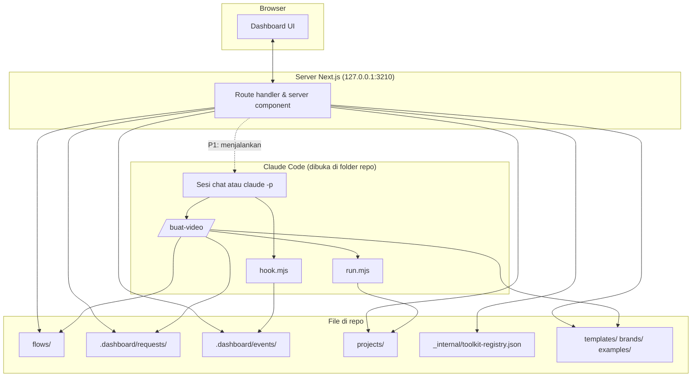
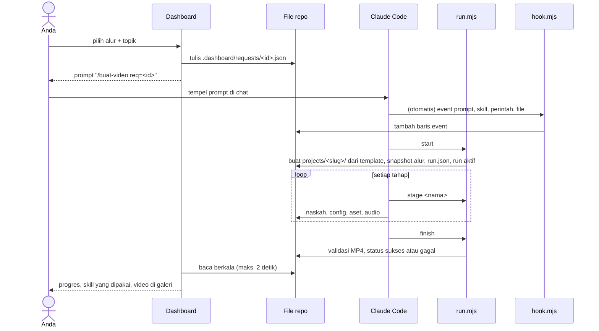

# PRD: Dashboard Video Generation (lokal)

| | |
|---|---|
| Versi | 0.3, sudah ditinjau reviewer independen dan memuat jawaban Q1, Q3, Q4 |
| Tanggal | 24 Oktober 2026 |
| Pemilik | Diyoncrz18 (pemilik repo) |
| Repo | `C:\MY FOLDER\VIDEO-GENERATION\claude-code-video-toolkit` |
| Status | Menunggu persetujuan. Setelah disetujui, lanjut ke rencana implementasi rinci. |

Prioritas di dokumen ini: **P0** wajib untuk MVP, **P1** setelah MVP, **P2** nanti.

---

## 1. Ringkasan

Sebuah dashboard web yang berjalan di laptop, dibangun di atas claude-code-video-toolkit. Di dashboard Anda:

1. menyusun **alur**, yaitu resep video yang bisa dipakai ulang (template, brand, format, susunan scene, gaya bahasa, audio, referensi desain, skill);
2. memesan video dari sebuah alur dengan topik tertentu;
3. memantau **proses eksekusi** saat Claude Code membuat video: tahap, skill, tool, perintah, file, error;
4. menonton dan mengunduh **video hasil** beserta riwayat versinya;
5. menjelajah **referensi desain** dan **katalog skill & tool**;
6. membaca **cara kerja** pipeline dari prompt sampai video.

Prinsip utamanya: **file di repo adalah satu-satunya sumber kebenaran.** Dashboard membaca dan menulis file; Claude membaca dan menulis file yang sama. Tidak ada database dan tidak ada server di internet.

---

## 2. Latar belakang

**Kondisi sekarang (24 Oktober 2026):**

- Toolkit sudah menjadi repo sendiri (commit awal `bcddb90`, tanpa remote).
- Contoh `hello-world` berhasil di-render di laptop: 25 detik, 1920×1080, 30 fps, selesai dalam ±1 menit 11 detik tanpa API key.
- Toolkit sudah punya bahan yang lengkap: 5 folder template, 4 brand, 9 folder contoh, 13 skill, 15 command, 27 tool Python, 7 transisi, 14 komponen. Semuanya tercatat di `_internal/toolkit-registry.json`. Siklus proyek video dicatat di `projects/<nama>/project.json`.
- Semua itu dijalankan lewat chat dan file. Browser hanya dipakai untuk pratinjau Remotion Studio per proyek.

**Masalah yang diselesaikan:**

1. Membuat video yang konsisten mengharuskan Anda menulis instruksi panjang berulang kali di chat.
2. Saat Claude bekerja, Anda tidak tahu tahap apa yang sedang berjalan, skill apa yang dipakai, atau kenapa sesuatu gagal.
3. Video hasil, referensi desain, dan katalog kemampuan tersebar di banyak folder.

---

## 3. Tujuan, bukan tujuan, anti-tujuan

### Tujuan (v1)

| ID | Tujuan |
|---|---|
| T1 | Menyusun dan mengelola alur lewat form. Alur tersimpan sebagai file yang dibaca Claude. |
| T2 | Memesan video dari alur + topik dengan usaha minimal: salin satu prompt pendek. Tombol Generate menyusul di P1. |
| T3 | Menampilkan proses eksekusi setiap video, baik saat berjalan maupun sebagai riwayat. |
| T4 | Galeri video: putar, unduh, lihat metadata dan versi. |
| T5 | Referensi desain yang bisa langsung dipasang ke alur. |
| T6 | Katalog skill & tool beserta kebutuhannya (API key, GPU cloud) dan statistik pemakaiannya. |
| T7 | Halaman "Cara Kerja" yang menjelaskan pipeline dari prompt sampai video. |

### Bukan tujuan (v1)

- Editor timeline geser-tarik. Untuk edit detail tetap memakai Remotion Studio atau chat.
- Multi-pengguna, login, atau hosting di internet.
- Dashboard memanggil API model AI sendiri. Semua kerja kreatif tetap dilakukan Claude Code.
- Publikasi ke media sosial dari dashboard. Toolkit sudah punya `/publish` lewat chat.
- Mesin render baru. Alur v1 hanya memakai template Remotion toolkit. Template Python (`concept-explainer-short`) tampil di Referensi Desain sebagai bacaan saja. HyperFrames dipertimbangkan di P2.
- Tampilan khusus ponsel. Cukup tidak rusak di layar kecil.

### Anti-tujuan (dianggap gagal walau secara teknis berjalan)

- Dashboard menyimpan data di tempat yang tidak dibaca Claude, sehingga alur di dashboard berbeda dengan yang dipakai Claude.
- Membuat video biasa masih mengharuskan Anda mengedit kode.
- Dashboard menampilkan "sukses" padahal render gagal atau file videonya rusak.
- Dashboard bisa diakses dari perangkat lain di jaringan, atau nilai API key muncul di browser.
- Alur kerja chat bawaan toolkit (`/video` dan command lain) menjadi rusak.
- Dashboard dipakai orang lain dengan langganan Claude Anda. Ini melanggar ketentuan Claude Code.

---

## 4. Pengguna dan skenario

**Pengguna:** satu orang, yaitu pemilik repo. Membuat konten video, paham dasar teknis, memakai Claude Code (aplikasi desktop, tab Code) dengan langganan sendiri, di Windows 11.

| ID | Skenario | Langkah |
|---|---|---|
| S1 | Membuat alur pertama | Alur → Buat alur → isi form → Simpan. File `flows/<id>/flow.json` terbentuk. |
| S2 | Membuat video | Beranda → Buat video → pilih alur, tulis topik dan catatan → dashboard menampilkan prompt `/buat-video req=<id>` → salin → tempel di Claude Code yang dibuka di folder repo → pantau di Eksekusi → video muncul di Video. |
| S3 | Menangani kegagalan | Eksekusi menunjukkan tahap yang gagal, pesan error, dan langkah terakhir. Anda menyalin prompt "perbaiki run ini" atau mengulang. |
| S4 | Review naskah dulu | Untuk alur dengan persetujuan "review naskah", Claude menulis naskah lalu run berstatus "Menunggu Anda". Naskah tampil di dashboard, Anda membalas di chat, lalu Claude melanjutkan. |
| S5 | Revisi video (P1) | Detail video → Revisi → tulis instruksi → prompt `/revisi-video` → versi baru tanpa menimpa versi lama. |
| S6 | Mencari referensi | Referensi Desain → lihat contoh, transisi, atau brand → "Pakai di alur". |

---

## 5. Istilah

| Istilah | Arti | Lokasi |
|---|---|---|
| **Alur** | Resep video yang dipakai ulang: template, brand, format, susunan scene dan aturannya, gaya bahasa, audio, referensi, skill, mode persetujuan. | `flows/<id>/flow.json` (baru) |
| **Permintaan** | Satu pesanan video dari dashboard: alur + topik + catatan. | `.dashboard/requests/<id>.json` (baru) |
| **Proyek** | Satu video beserta semua filenya, memakai format toolkit. | `projects/<slug>/` (sudah ada) |
| **Run (eksekusi)** | Satu kali proses dari prompt sampai selesai atau gagal untuk satu proyek. | `projects/<slug>/runs/<runId>/` (baru) |
| **Tahap** | Bagian besar dari run: persiapan, naskah, aset, audio, komposisi, QC, render, review visual, selesai. | dicatat oleh `run.mjs` |
| **Event** | Satu aktivitas Claude yang dicatat hook: prompt, skill, perintah, tulis file, subagent, berhenti. | `.dashboard/events/` dan folder run |
| **Template** | Proyek dasar visual. Alur v1 hanya memakai template Remotion; template Python tampil sebagai referensi saja. | `templates/` (sudah ada) |
| **Brand** | Warna, font, tipografi, suara, logo. | `brands/` (sudah ada) |
| **Skill** | Paket pengetahuan yang dimuat Claude. | `.claude/skills/` toolkit dan `~/.claude/skills/` |
| **Command** | Perintah garis miring di chat, misalnya `/video`. | `.claude/commands/` |
| **Tool** | Skrip Python toolkit untuk suara, musik, QC, dan lainnya. | `tools/` |
| **Registry** | Daftar resmi skill, command, tool, template, contoh, transisi, komponen, dan brand milik toolkit. | `_internal/toolkit-registry.json` |

---

## 6. Cara kerja sistem

### 6.1 Prinsip desain

1. **File adalah sumber kebenaran.** Dashboard tidak memakai database.
2. **Dashboard tidak membuat video.** Claude yang membuat; dashboard memesan dan menampilkan.
3. **Pencatatan otomatis.** Pencatatan tidak bergantung pada Claude "ingat" menulis log. Hook Claude Code mencatat setiap aktivitas, dan helper `run.mjs` mencatat tahap serta memvalidasi hasil.
4. **Pakai ulang struktur toolkit**, yaitu `project.json`, registry, template, dan brand. Perilaku command lama tidak diubah.

### 6.2 Arsitektur



### 6.3 Alur data untuk satu video



### 6.4 Mode pemicu

| Mode | Prioritas | Cara kerja | Catatan |
|---|---|---|---|
| **Chat** | P0 | Dashboard menampilkan prompt pendek, Anda menyalin dan menempelnya di Claude Code. | Sesuai ide awal. Tidak ada risiko ketentuan. |
| **Tombol Generate** | P1 | Server dashboard menjalankan `claude -p "/buat-video req=<id>" --output-format stream-json --verbose` di folder repo dengan izin tool terbatas. | Boleh untuk pemakaian pribadi dengan langganan sendiri. Risikonya ada di §16. |

**Syarat kedua mode:** Claude Code dibuka di folder repo. Dengan begitu command `/buat-video`, `CLAUDE.md` toolkit, dan hook proyek ikut termuat.

---

## 7. Struktur dashboard

**Menu:** Beranda · Alur · Video · Eksekusi · Referensi Desain · Skill & Tools · Cara Kerja · Pengaturan

### 7.1 Beranda

```
┌──────────────┬───────────────────────────────────────────────────────┐
│ Beranda      │ EKSEKUSI AKTIF                                        │
│ Alur         │ ● "Cara kerja pelangi" · alur Contoh Penjelasan v3    │
│ Video        │   Tahap: Render · berjalan 02:41                      │
│ Eksekusi     │   Skill: remotion-official, frontend-design   [Detail]│
│ Referensi    ├───────────────────────────────────────────────────────┤
│ Skill & Tools│ BUAT VIDEO                                            │
│ Cara Kerja   │ Alur [Contoh Penjelasan ▾]  Topik [________________]  │
│ Pengaturan   │ Catatan [__________________________]  [Buat prompt]   │
│              │ /buat-video req=7f3a                         [Salin]  │
│              ├───────────────────────────────────────────────────────┤
│              │ VIDEO TERBARU  [▶][▶][▶][▶][▶][▶]                     │
│              ├───────────────────────────────────────────────────────┤
│              │ KESEHATAN SISTEM  Node ✓  npm ✓  uv ✓  Claude CLI ✓   │
│              │ Hook terpasang ✓   API key terisi: 1 dari 6           │
└──────────────┴───────────────────────────────────────────────────────┘
```

### 7.2 Editor alur

```
Alur › Contoh Penjelasan                                   v3  [Simpan]
┌ Info ────────────────────────────────────────────────────────────────┐
│ Nama [Contoh Penjelasan ]   Deskripsi [Penjelasan singkat 16:9     ] │
├ Template & brand ──────────────┬ Format output ──────────────────────┤
│ Template [sprint-review ▾]     │ Rasio 16:9 · 1920×1080 · 30 fps     │
│ Brand    [default ▾] ■ ■ ■ ■   │ Target durasi [30] detik            │
├ Susunan scene ───────────────────────────────────────────────────────┤
│ |Hook 3s|   Poin-poin 12s      |  Fakta 8s  |Penutup 5s|  = 28 / 30  │
│ 1 Hook        3 dtk  narasi: ya   [Naik] [Turun] [Ubah] [Hapus]      │
│ 2 Poin-poin  12 dtk  narasi: ya   [Naik] [Turun] [Ubah] [Hapus]      │
│ [+ Tambah scene]                                                     │
├ Gaya & bahasa ───┬ Audio ───────────┬ Referensi ───┬ Skill ───────────┤
│ Bahasa: Indonesia│ Suara: tidak     │ hello-world  │ remotion-official│
│ Nada: santai     │ Musik: tidak     │ zoomBlur     │ frontend-design  │
├ Persetujuan: (•) Otomatis  ( ) Review naskah dulu ───────────────────┤
│ Catatan untuk Claude [_____________________________________________] │
└──────────────────────────────────────────────────────────────────────┘
```

### 7.3 Detail eksekusi

```
Eksekusi › 20261024-0153 · "Cara kerja pelangi"          ● Berjalan 02:41
Alur Contoh Penjelasan v3 · pemicu: chat · proyek: cara-kerja-pelangi
[✓ Persiapan 0:35][✓ Naskah 0:48][– Aset][– Audio][✓ Komposisi 0:20]
[✓ QC 0:05][● Render 0:58…][ Review visual ][ Selesai ]
Skill: remotion-official ✓   frontend-design (direncanakan, belum dipakai)
Tool Python: qc   ·   File diubah: 4   ·   Perintah: 6
LINIMASA                                               [Semua jenis ▾]
01:53:02  Prompt    /buat-video req=7f3a
01:53:05  Skill     remotion-official
01:53:09  Perintah  node dashboard/bin/run.mjs start …        ✓ 1,2 dtk
01:53:40  Tahap     Naskah
01:53:52  File      projects/cara-kerja-pelangi/VOICEOVER-SCRIPT.md
```

### 7.4 Detail video

Pemutar video, tombol unduh, metadata, naskah, tabel scene, daftar versi, dan riwayat run. Lihat GAL-02.

---

## 8. Kebutuhan fungsional

### 8.1 Jembatan ke Claude (JMB): fondasi

| ID | Kebutuhan | P | Kriteria terima |
|---|---|---|---|
| JMB-01 | Command `.claude/commands/buat-video.md` menerima `req=<id>`, `perbaiki=<runId>`, atau `<id-alur> <topik>`, lalu menjalankan pipeline sesuai alur (§10.1). | P0 | Dari chat, `/buat-video contoh-penjelasan "Cara kerja pelangi"` menghasilkan MP4 di proyek baru tanpa pertanyaan lanjutan, untuk alur dengan persetujuan otomatis. |
| JMB-02 | Helper `run.mjs` dengan subperintah `start`, `stage`, `wait`, `finish`, `fail`. `start` membuat proyek dari template alur, menulis `project.json` format toolkit (ditambah `flow` dan `topic`), menyimpan snapshot alur, membuat manifest run, dan menandai run aktif. Dengan `--project <slug>`, `start` memulai run baru di proyek yang sudah ada tanpa menyalin ulang template. | P0 | Ada unit test untuk tiap subperintah. Slug proyek aman walau topik berisi karakter khusus. |
| JMB-03 | `finish` hanya menandai sukses jika file MP4 ada, ukurannya lebih dari 0, dan durasinya terbaca lebih dari 0 (memakai ffprobe dari dependensi dashboard sendiri, karena ffprobe tidak ada di PATH laptop ini). Jika tidak, run gagal dengan alasan yang jelas. | P0 | Uji: file kosong → gagal. File valid → sukses. |
| JMB-04 | Hook proyek di `.claude/settings.json` menjalankan `hook.mjs` saat prompt dikirim, sebelum dan sesudah tool, saat Claude berhenti, dan di awal/akhir sesi. Yang dicatat: waktu, sesi, run aktif, jenis tool, ringkasan (nama skill, perintah dipotong 500 karakter, path file), dan status berhasil/gagal. Isi file dan output panjang tidak dicatat. | P0 | Satu run menghasilkan minimal event prompt, ≥1 skill, perintah render, dan berhenti. Kegagalan hook tidak menghentikan Claude: hook selalu keluar dengan kode 0 dan mencatat errornya ke file sendiri. |
| JMB-05 | Hanya satu run aktif pada satu waktu. `start` menolak bila ada run aktif yang masih hidup. Run tanpa aktivitas lebih dari 15 menit ditandai "terhenti", kecuali event terakhirnya adalah permintaan izin (ditampilkan "Menunggu izin Anda"). | P0 | Uji dua `start` berurutan: yang kedua ditolak dengan pesan jelas. |
| JMB-06 | Setiap run sukses menyimpan video sebagai versi sendiri dan tidak menimpa versi lama. | P0 | Dua run di proyek yang sama menghasilkan dua file video. |
| JMB-07 | Proyek yang dibuat lewat `/video` (tanpa alur) tetap tampil di dashboard sebagai "tanpa alur". | P0 | Proyek tanpa field `flow` tampil tanpa error. |
| JMB-08 | Perbaiki dan ulang. "Perbaiki" (`/buat-video perbaiki=<runId>`) membuat run baru di proyek yang sama, melanjutkan dari file yang ada, dan membaca error run sebelumnya. "Ulang" membuat permintaan baru dengan alur dan topik yang sama, sehingga terbentuk proyek baru dengan akhiran `-2`, `-3`, dan seterusnya. Status gagal, dibatalkan, dan terhenti bersifat final. | P0 | Run gagal yang diperbaiki menghasilkan run baru berstatus sukses di proyek yang sama, dan run lama tetap tercatat gagal. |
| JMB-09 | Run hanya berjalan di folder repo utama. `run.mjs` mendeteksi git worktree (misalnya sesi aplikasi desktop yang dibuat di worktree) dan menolak dengan pesan cara membuka sesi di folder utama. | P0 | `start` dari worktree gagal dengan pesan jelas dan tidak membuat proyek. |
| JMB-10 | Run lewat chat berjalan tanpa jeda izin. `.claude/settings.json` proyek berisi daftar izin khusus perintah pipeline (`node dashboard/bin/*`, `npm install` dan `npm run` di `projects/`, `npx remotion *`, `uv run tools/*`). Teks command menyatakan bahwa ini eksekusi alur yang sudah disetujui, sehingga Claude tidak memulai brainstorming atau pertanyaan klarifikasi, kecuali untuk review naskah. | P0 | Satu run alur otomatis selesai tanpa satu pun prompt izin atau pertanyaan. |
| JMB-11 | Command `/revisi-video <slug> <instruksi>` membuat run baru di proyek yang sama (memakai mekanisme JMB-08) dan menghasilkan versi baru. | P1 | Versi lama tetap bisa diputar. |
| JMB-12 | Render lewat helper yang menulis progres (persen, dibaca dari keluaran Remotion) ke manifest run. | P1 | Progres naik selama render. Jika format keluaran tidak dikenali, tampil "sedang render" tanpa persen. |
| JMB-13 | Mode tombol Generate: menjalankan Claude tanpa chat, menyimpan keluaran stream, dan bisa membatalkan run. | P1 | Lihat §10.3. |

### 8.2 Beranda (BRD)

| ID | Kebutuhan | P |
|---|---|---|
| BRD-01 | Kartu run aktif: alur, topik, tahap, waktu berjalan, skill yang sudah dipakai, tautan ke detail. | P0 |
| BRD-02 | Form cepat "Buat video": pilih alur, isi topik dan catatan, lalu dashboard membuat permintaan dan menampilkan prompt dengan tombol salin. | P0 |
| BRD-03 | Enam video terbaru dengan pratinjau. | P0 |
| BRD-04 | Kesehatan sistem: versi Node, npm, uv, Claude CLI (atau "tidak ditemukan"), status hook terpasang, dan daftar API key yang dibutuhkan dengan status terisi/kosong. Nilai key tidak pernah ditampilkan. | P0 |
| BRD-05 | Petunjuk mulai: "Buka Claude Code di folder repo utama, bukan worktree", dengan path yang bisa disalin. | P0 |

### 8.3 Alur (ALR)

| ID | Kebutuhan | P | Kriteria terima |
|---|---|---|---|
| ALR-01 | Daftar alur: nama, template, brand, format, jumlah scene, total durasi, jumlah video dibuat, terakhir dipakai. | P0 | |
| ALR-02 | Form buat/edit alur dengan bagian: Info, Template & brand, Format output, Susunan scene, Gaya & bahasa, Audio, Referensi, Skill, Persetujuan, Catatan untuk Claude. | P0 | Simpan menghasilkan `flow.json` yang lolos validasi. |
| ALR-03 | Susunan scene: tambah, hapus, ubah urutan dengan tombol naik/turun (geser-tarik di P1). Tiap scene punya label, tujuan, durasi, aturan, narasi ya/tidak, petunjuk visual, dan transisi keluar (pilihan dari registry). | P0 | |
| ALR-04 | Visual alur: bar horizontal yang panjangnya sebanding dengan durasi tiap scene, total dibanding target, dan peringatan bila selisihnya lebih dari 10%. | P0 | |
| ALR-05 | Validasi memakai skema yang sama dengan `run.mjs`: id unik, template ada dan berbasis Remotion, brand ada, durasi lebih dari 0, minimal 1 scene, rasio aspek didukung template, dan provider suara (bila aktif) mendukung bahasa alur. Qwen3-TTS tidak mendukung Bahasa Indonesia. Pesan error dalam Bahasa Indonesia. | P0 | Alur tidak valid tidak bisa disimpan. `run.mjs start` juga menolak alur tidak valid. |
| ALR-06 | Duplikat alur. Arsipkan alur dengan memindahkannya ke `flows/.archive/`, tanpa hapus permanen. | P0 | |
| ALR-07 | Nomor versi naik setiap kali disimpan. Run menyimpan snapshot versi yang dipakai. | P0 | Mengedit alur tidak mengubah tampilan run lama. |
| ALR-08 | Tandai kebutuhan alur: bila memakai ElevenLabs, Modal, RunPod, atau Ideogram, tampilkan "butuh layanan cloud/berbayar" dan cek key-nya di `.env`. | P0 | |
| ALR-09 | Pratinjau gaya: swatch warna dan font brand yang dipilih. | P1 | |
| ALR-10 | "Jadikan acuan": pilih video sukses sebagai acuan visual alur. | P1 | |
| ALR-11 | Impor/ekspor alur sebagai file JSON. | P2 | |

### 8.4 Video (GAL)

| ID | Kebutuhan | P |
|---|---|---|
| GAL-01 | Grid proyek: pratinjau, judul/topik, alur, status/fase, durasi, tanggal. Bisa difilter per alur dan status, diurutkan dari terbaru. | P0 |
| GAL-02 | Detail video: pemutar dengan seek (HTTP Range), unduh, metadata (resolusi, durasi, ukuran, fps, template, brand, alur + versi, waktu render), naskah `VOICEOVER-SCRIPT.md` yang dirender aman, tabel scene dari `project.json`, daftar versi, dan riwayat run. | P0 |
| GAL-03 | Tombol "Buka folder" (Explorer), "Buka di Remotion Studio", dan "Revisi". | P1 |
| GAL-04 | Thumbnail otomatis yang dibuat `finish`. Di P0 cukup `<video preload="metadata">` sebagai pratinjau. | P1 |
| GAL-05 | Hapus video/proyek berarti memindahkannya ke `projects/.trash/`, dengan konfirmasi. | P1 |

### 8.5 Eksekusi (EKS)

| ID | Kebutuhan | P |
|---|---|---|
| EKS-01 | Daftar run: status (berjalan, menunggu Anda, sukses, gagal, dibatalkan, terhenti), alur, topik, waktu mulai, durasi, pemicu (chat/dashboard). | P0 |
| EKS-02 | Detail run: bar tahap dengan status dan durasi tiap tahap, serta linimasa event dengan ikon per jenis (prompt, skill, perintah, file, subagent, tahap, berhenti) dan filter jenis. | P0 |
| EKS-03 | Ringkasan run: skill yang dipakai dibanding skill yang direncanakan alur, tool Python yang dipakai (dikenali dari `uv run tools/<nama>.py`), file yang dibuat/diubah, perintah render dan lamanya. | P0 |
| EKS-04 | Error: tahap yang gagal, pesan, event terakhir sebelum gagal, dan prompt "perbaiki run ini" yang bisa disalin. | P0 |
| EKS-05 | Pembaruan langsung selama run berjalan, maksimal 2 detik, tanpa reload. | P0 |
| EKS-06 | Status "Menunggu Anda" saat alur memakai review naskah atau saat Claude berhenti padahal run masih aktif. Naskah dan instruksi "balas di chat" ditampilkan. Status "Menunggu izin Anda" saat Claude tertahan prompt izin. | P0 |
| EKS-07 | Prompt asli yang memulai run (diambil dari event prompt di sesi yang sama). | P0 |
| EKS-08 | Tombol "Tandai gagal" untuk run yang terhenti. | P0 |
| EKS-09 | Progres render (persen dan estimasi waktu). | P1 |
| EKS-10 | Batalkan run yang dijalankan lewat tombol Generate. | P1 |
| EKS-11 | Statistik: rata-rata durasi per tahap per alur dan tingkat sukses. | P2 |

### 8.6 Referensi Desain (REF)

| ID | Kebutuhan | P |
|---|---|---|
| REF-01 | Tab Contoh: gabungan registry dan isi folder `examples/` (deskripsi, template, tingkat kesulitan). Putar videonya bila sudah di-render; bila belum, tampilkan perintah render untuk disalin. Tandai ketidaksesuaian antara registry dan folder (lihat Lampiran A). | P0 |
| REF-02 | Tab Template: deskripsi, status (stable/beta), engine (Remotion/Python), rasio aspek bawaan, kebutuhan API/GPU. Template Python ditandai "belum bisa dipakai di alur v1". | P0 |
| REF-03 | Tab Brand: swatch warna, font, skala tipografi dari `brand.json`, dan aset logo. | P0 |
| REF-04 | Tab Transisi & Komponen: deskripsi, opsi, dan "cocok untuk" dari registry. Pratinjau gerak menyusul di P2. | P0 |
| REF-05 | "Pakai di alur" untuk item registry: menambahkan referensi ke alur yang dipilih. | P0 |
| REF-06 | Inspirasi saya: unggah gambar/video (maks. 20 MB per file) atau simpan tautan dengan catatan, disimpan di `references/`, lalu bisa dipasang ke alur. | P1 |
| REF-07 | Render contoh langsung dari dashboard (`npm install` + render, tanpa Claude). | P1 |

### 8.7 Skill & Tools (SKL)

| ID | Kebutuhan | P |
|---|---|---|
| SKL-01 | Katalog dari registry: skill, command, tool, lengkap dengan deskripsi, status, path, dan tanggal update. | P0 |
| SKL-02 | Kebutuhan tiap item (env var/API key, GPU cloud) dengan status terisi/kosong dari `.env`, tanpa nilai. | P0 |
| SKL-03 | Pemakaian: jumlah run yang memakai, kapan terakhir dipakai, dan alur mana yang mencantumkannya. | P0 |
| SKL-04 | Skill tingkat pengguna (`~/.claude/skills/*/SKILL.md`) dan skill di folder proyek yang belum masuk registry. | P1 |
| SKL-05 | Lihat isi `SKILL.md` (baca saja, dirender aman). | P1 |

### 8.8 Cara Kerja (CK)

| ID | Kebutuhan | P |
|---|---|---|
| CK-01 | Diagram pipeline dari prompt sampai galeri, dengan skill/tool yang biasa dipakai di tiap tahap dan tautan ke halaman terkait. | P0 |
| CK-02 | Penjelasan mode pemicu, syarat (buka Claude di folder repo), dan biaya: mana yang gratis dan lokal, mana yang butuh cloud. | P0 |
| CK-03 | Isi halaman diambil dari file markdown di repo (`dashboard/content/cara-kerja.md`) agar mudah diubah. | P0 |

### 8.9 Pengaturan (SET)

| ID | Kebutuhan | P |
|---|---|---|
| SET-01 | Tampilkan path repo dan folder data. | P0 |
| SET-02 | Tombol pemeriksaan ulang lingkungan (sama dengan BRD-04). | P0 |
| SET-03 | Atur interval pembaruan dan alur default. | P1 |
| SET-04 | Aktifkan tombol Generate dan atur daftar izin tool untuk mode tanpa chat, disertai peringatan risiko. | P1 |

---

## 9. Kontrak data

### 9.1 Struktur folder

```
claude-code-video-toolkit/
├── dashboard/                      BARU  aplikasi Next.js
│   ├── bin/run.mjs                 BARU  helper run (start/stage/wait/finish/fail)
│   ├── bin/hook.mjs                BARU  pencatat event dari hook, tanpa dependensi
│   └── content/cara-kerja.md       BARU  isi halaman Cara Kerja
├── flows/<id>/flow.json            BARU  definisi alur (masuk git)
├── flows/<id>/refs/                BARU  gambar referensi khusus alur (P1)
├── flows/.archive/                 BARU  alur yang diarsipkan
├── references/                     BARU  inspirasi umum (P1)
├── .claude/commands/buat-video.md  BARU  command jembatan
├── .claude/settings.json           UBAH  tambah konfigurasi hook
├── .dashboard/                     BARU  data runtime (diabaikan git)
│   ├── requests/<id>.json                permintaan video
│   ├── events/<sessionId>.jsonl          semua event per sesi
│   └── active-run.json                   penanda run aktif
├── projects/<slug>/                ADA   satu proyek per video (diabaikan git)
│   ├── project.json                ADA   ditambah field opsional flow, topic, latestRun
│   ├── runs/<runId>/run.json       BARU  manifest run
│   ├── runs/<runId>/flow.json      BARU  snapshot alur saat run dimulai
│   ├── runs/<runId>/events.jsonl   BARU  event milik run ini
│   └── out/<runId>.mp4             UBAH  satu file per versi
├── lib/project/types.ts            UBAH  field opsional baru
└── templates/ brands/ examples/ _internal/   ADA, dibaca dashboard
```

Tambahan `.gitignore`: `.dashboard/`, `dashboard/node_modules/`, `dashboard/.next/`. Folder `projects/` sudah diabaikan git oleh toolkit.

### 9.2 `flow.json`

```json
{
  "id": "contoh-penjelasan",
  "name": "Contoh Penjelasan",
  "description": "Penjelasan singkat 16:9 tanpa suara, render lokal gratis",
  "version": 3,
  "updatedAt": "2026-10-24T01:50:00Z",
  "template": "sprint-review",
  "brand": "default",
  "output": { "aspectRatio": "16:9", "width": 1920, "height": 1080, "fps": 30, "targetDurationSeconds": 30 },
  "language": "id",
  "style": { "tone": "santai dan jelas", "audience": "umum", "rules": ["kalimat pendek", "tanpa emoji"] },
  "scenes": [
    { "id": "hook", "label": "Hook", "goal": "Pertanyaan yang memancing rasa penasaran", "durationSeconds": 3,
      "rules": ["maksimal 8 kata"], "narration": true, "visualHint": "judul besar", "transitionOut": "zoomBlur" },
    { "id": "poin", "label": "Poin-poin", "goal": "Tiga poin penjelasan inti", "durationSeconds": 12,
      "rules": ["tepat 3 poin"], "narration": true }
  ],
  "audio": {
    "voiceover": { "enabled": false },
    "music": { "enabled": false },
    "captions": { "enabled": false }
  },
  "references": [
    { "kind": "example", "id": "hello-world" },
    { "kind": "transition", "id": "zoomBlur" }
  ],
  "skills": ["remotion-official"],
  "approval": "auto",
  "notes": "Catatan bebas untuk Claude"
}
```

| Field | Tipe | Wajib | Keterangan |
|---|---|---|---|
| `id` | slug | ya | Sama dengan nama folder. |
| `name`, `description` | teks | name wajib | |
| `version` | bilangan bulat | ya | Naik setiap kali disimpan. |
| `updatedAt` | ISO 8601 | ya | |
| `template` | id | ya | Harus ada di `templates/` dan berbasis Remotion. |
| `brand` | id | ya | Harus ada di `brands/`. |
| `output.aspectRatio` | `16:9`, `9:16`, atau `1:1` | ya | Harus didukung template. Template Remotion toolkit saat ini 16:9; format 9:16 butuh template vertikal baru (M5). |
| `output.width`, `height`, `fps`, `targetDurationSeconds` | angka | ya | Nilai bawaan diambil dari template. |
| `language` | kode bahasa | ya | Bahasa teks dan narasi. |
| `style.tone`, `style.audience`, `style.rules` | teks / daftar | tidak | Aturan global untuk seluruh video. |
| `scenes[]` | daftar, minimal 1 | ya | Scene bersifat **semantik**: Claude menerjemahkannya ke komponen template (§10.1). |
| `scenes[].id`, `label`, `goal`, `durationSeconds`, `narration` | | ya | |
| `scenes[].rules`, `visualHint`, `transitionOut` | | tidak | `transitionOut` diambil dari id transisi di registry. |
| `audio.voiceover` | `{enabled, provider?, voice?}` | ya | provider wajib bila enabled: `elevenlabs`, `qwen3`, atau `60db` (sesuai `tools/voiceover.py`). Qwen3 hanya untuk bahasa yang didukungnya, dan Bahasa Indonesia tidak termasuk. |
| `audio.music` | `{enabled, preset?, prompt?}` | ya | preset sesuai `tools/music_gen.py`. |
| `audio.captions` | `{enabled}` | ya | |
| `references[]` | `{kind, id?, path?, url?, note?}` | tidak | kind: `example`, `template`, `transition`, `component`, `brand`, `project`, `upload`, `link`. |
| `skills[]` | daftar nama skill | tidak | Skill yang wajib dimuat Claude di awal run. |
| `approval` | `auto` atau `script-review` | ya | Mode tombol Generate memaksa `auto` sampai fitur lanjutan run tersedia. |
| `notes` | teks | tidak | |

### 9.3 Permintaan: `.dashboard/requests/<id>.json`

```json
{ "id": "7f3a", "flow": "contoh-penjelasan", "topic": "Cara kerja pelangi",
  "notes": "fokus ke anak SD", "createdAt": "2026-10-24T01:52:40Z",
  "status": "baru", "runId": null }
```

`status` berubah dari `baru` menjadi `diambil` saat `run.mjs start` membacanya, lalu `runId` diisi. Teks topik dan catatan hanya ada di file ini. Teks itu tidak pernah disisipkan ke perintah shell.

### 9.4 Manifest run: `projects/<slug>/runs/<runId>/run.json`

```json
{
  "runId": "20261024-0153-7f3a",
  "project": "cara-kerja-pelangi",
  "flow": "contoh-penjelasan", "flowVersion": 3,
  "request": "7f3a", "topic": "Cara kerja pelangi",
  "trigger": "chat", "retryOf": null,
  "sessionId": "…",
  "claudeCodeVersion": "…",
  "status": "running",
  "stage": "render",
  "stages": [ { "name": "setup", "startedAt": "…", "endedAt": "…" } ],
  "startedAt": "…", "endedAt": null, "lastActivityAt": "…",
  "output": { "file": "out/20261024-0153-7f3a.mp4", "durationSeconds": 28.0,
              "width": 1920, "height": 1080, "fps": 30, "sizeBytes": 1150000 },
  "error": null
}
```

- `status`: `running`, `waiting`, `success`, `failed`, `cancelled`, atau `abandoned`.
- `stage`: `setup`, `script`, `assets`, `audio`, `compose`, `qc`, `render`, `review`, atau `done`.
- Setiap perubahan tahap juga memperbarui `project.json.phase` sesuai siklus toolkit: setup/script → `planning`, assets → `assets`, audio → `audio`, compose/qc → `editing`, render/review → `rendering`, done → `complete`.

### 9.5 Event: satu baris JSON

```json
{ "ts": "2026-10-24T01:53:05.120Z", "sessionId": "…", "runId": "20261024-0153-7f3a",
  "type": "skill", "tool": "Skill", "summary": "remotion-official",
  "detail": { }, "ok": true }
```

- `type`: `prompt`, `skill`, `command`, `file`, `agent`, `tool`, `stage`, `stop`, `session-start`, atau `session-end`.
- Event `stage` ditulis oleh `run.mjs`. Event lainnya ditulis oleh `hook.mjs`.
- Event pembacaan file (Read, Grep, Glob) cukup dihitung jumlahnya per run, tidak dicatat satu per satu.

### 9.6 Perluasan `project.json`

Tiga field opsional ditambahkan di `lib/project/types.ts`: `flow?: string`, `topic?: string`, dan `latestRun?: string`. Field lain dan perilaku `/video` tidak berubah.

---

## 10. Integrasi Claude Code

### 10.1 Isi command `/buat-video` (garis besar)

1. Baca argumen. `req=<id>` berarti baca file permintaan. `perbaiki=<runId>` berarti run baru di proyek milik run tersebut (JMB-08). Selain itu, argumen pertama adalah id alur dan sisanya topik.
2. Jalankan `node dashboard/bin/run.mjs start …` untuk mendapatkan slug proyek dan runId.
3. Muat skill yang tercantum di `flow.skills`.
4. Pelajari referensi alur: untuk contoh atau proyek, baca sumbernya; untuk gambar, lihat gambarnya; untuk tautan, perlakukan sebagai catatan.
5. Tahap `script`: tulis `VOICEOVER-SCRIPT.md` dan isi config template sesuai susunan scene, aturan, bahasa, dan durasi alur.
6. Bila `approval` = `script-review`: jalankan `run.mjs wait --reason "review naskah"`, minta persetujuan di chat, lalu lanjut setelah disetujui.
7. Tahap `assets` dan `audio`, hanya bila alur memintanya, memakai tool toolkit (`voiceover.py`, `music_gen.py`, `captions.py`).
8. Tahap `compose`: sesuaikan komponen **di salinan proyek**, bukan di template asli.
9. Tahap `qc`: jalankan `uv run tools/qc.py --project projects/<slug>` bila uv tersedia.
10. Tahap `render`: render di latar belakang bila videonya panjang.
11. Tahap `review`: ambil 3–5 frame, periksa tampilannya, perbaiki bila perlu.
12. Jalankan `run.mjs finish`, atau `run.mjs fail --reason "…"` bila gagal.

**Aturan perilaku:** command ini menjalankan alur yang sudah disetujui, jadi Claude tidak memulai brainstorming atau pertanyaan klarifikasi. Jangan bertanya di tengah run kecuali untuk review naskah atau keputusan yang benar-benar butuh Anda. Setiap kegagalan harus berakhir dengan `fail` beserta alasannya, tidak boleh berhenti diam-diam. Setiap tahap diawali `run.mjs stage <nama>`.

### 10.2 Hook

- Dikonfigurasi di `.claude/settings.json` proyek, sehingga hanya aktif saat Claude Code dibuka di folder repo.
- Perintah hook memakai path yang dikutip karena folder repo mengandung spasi, misalnya `node "$CLAUDE_PROJECT_DIR/dashboard/bin/hook.mjs"`.
- Event yang dipakai: prompt dikirim, sebelum dan sesudah tool, Claude berhenti, awal dan akhir sesi. **Builder wajib memverifikasi nama event, isi payload, dan shell yang menjalankan hook di Windows** di dokumentasi hooks untuk versi Claude Code yang terpasang.
- `hook.mjs` harus cepat (target di bawah 100 ms), tanpa dependensi, selalu keluar dengan kode 0, mengabaikan field yang tidak dikenal, dan menulis errornya ke `.dashboard/hook-errors.log`.
- Penghubung event ke run: `hook.mjs` membaca `.dashboard/active-run.json`. Bila ada run aktif dari sesi yang sama, event juga ditulis ke `events.jsonl` milik run tersebut. Builder bebas memilih cara mengisi `sessionId` di run aktif, misalnya dari payload hook pertama setelah `start`.
- Event notifikasi permintaan izin dipakai untuk status "Menunggu izin Anda".
- Pengurai perintah dan daftar izin memperhitungkan prefix `rtk`. Aturan global di `~/.claude/CLAUDE.md` meminta prefix ini, walau `rtk` belum terpasang di laptop ini.

### 10.3 Mode tombol Generate (P1)

- Server menjalankan `claude -p "/buat-video req=<id>" --output-format stream-json --verbose` di folder repo dengan daftar tool yang diizinkan (`--allowedTools`), misalnya `Bash(node dashboard/bin/*)`, `Bash(npm *)`, `Bash(npx remotion *)`, `Bash(uv run tools/*)`, Read, Write, Edit, Skill, ditambah `--permission-prompts none` agar tidak tertahan menunggu izin.
- Proses dijalankan dengan argumen berbentuk array, tanpa shell. Keluarannya disimpan ke folder run.
- Pembatalan: hentikan seluruh pohon proses (di Windows, `taskkill /T`), lalu `run.mjs fail --reason "dibatalkan"`.
- Error autentikasi dari stream ditampilkan sebagai pesan jelas yang menyarankan mode chat.
- Melanjutkan run yang menunggu (`--resume <sessionId>`) masuk P2.

---

## 11. Kebutuhan non-fungsional

| ID | Kebutuhan |
|---|---|
| NFR-01 | Server hanya mendengarkan `127.0.0.1`. Tidak bisa diakses dari perangkat lain. |
| NFR-02 | Semua baca/tulis file lewat satu fungsi penjaga yang menolak path di luar root repo, termasuk `..` dan symlink. |
| NFR-03 | Isi `.env` tidak pernah dikirim ke browser. Yang dikirim hanya status ada atau tidak. |
| NFR-04 | Proses anak dijalankan dengan argumen array, tanpa string shell. Teks dari pengguna tidak pernah masuk ke perintah shell. |
| NFR-05 | Markdown (naskah, SKILL.md) dirender tanpa HTML mentah. |
| NFR-06 | Halaman utama tampil dalam waktu kurang dari 1 detik untuk sampai 200 proyek. Galeri hanya memuat metadata video, bukan file penuh. |
| NFR-07 | File rusak atau hilang ditampilkan sebagai "data rusak" pada item itu saja, bukan membuat seluruh halaman error. |
| NFR-08 | Berjalan di Windows 11, path berspasi (`C:\MY FOLDER\...`), Chrome/Edge terbaru, dan Node 24. |
| NFR-09 | Antarmuka berbahasa Indonesia. Kode dan nama file berbahasa Inggris. |
| NFR-10 | Aksesibilitas dasar: bisa dinavigasi dengan keyboard, form berlabel, kontras minimal AA, status tidak hanya dibedakan dengan warna. |
| NFR-11 | Dashboard tidak pernah menghapus permanen. Yang ada hanya arsip dan trash. |
| NFR-12 | Perilaku command toolkit yang sudah ada tidak berubah. |

---

## 12. Teknologi

Ini keputusan saya dan bisa diubah:

- **Next.js** (App Router, versi stabil terbaru) + **TypeScript** + **Tailwind CSS** + **shadcn/ui**. Satu proses `npm run dev` di folder `dashboard/`, port 3210, host `127.0.0.1`. Port 3000 dihindari karena dipakai Remotion Studio.
- **Zod** untuk skema alur, permintaan, run, dan event. Skema yang sama dipakai dashboard dan `run.mjs`. `hook.mjs` tidak memakai dependensi agar cepat.
- **Pembaruan langsung** dengan polling setiap 2 detik, hanya di halaman yang butuh data langsung.
- **Pemutar video** memakai `<video>` bawaan browser, dengan endpoint streaming yang mendukung HTTP Range.
- **ffprobe** diambil dari dependensi dashboard (paket Remotion), karena ffprobe dan ffmpeg tidak ada di PATH laptop ini.
- **Tes**: Vitest untuk unit test. Playwright untuk smoke test end-to-end (P1).
- **P1**: `.claude/launch.json` agar dashboard bisa dibuka di panel browser aplikasi Claude.

---

## 13. Rencana pengembangan

Ukuran: **S** = kurang dari ½ sesi kerja, **M** = 1–2 sesi, **L** = 3 sesi atau lebih. Satu sesi kerja adalah satu sesi Claude Code yang fokus.

| Milestone | Isi | Ukuran | Selesai jika |
|---|---|---|---|
| **M0: Kontrak & jembatan** (tanpa UI) | Skema alur, satu alur contoh 16:9 tanpa API (dasar: template sprint-review seperti hello-world), `run.mjs`, `hook.mjs` + konfigurasi hook, `/buat-video`, perluasan `project.json`, `.gitignore`, daftar izin proyek, deteksi worktree, mekanisme perbaiki. | M | Dari chat, video jadi tanpa prompt izin. `run.json` dan event terisi. Kegagalan yang dipaksa tercatat sebagai gagal, dan perbaikannya menghasilkan run sukses. |
| **M1: Kerangka & tampilan baca** | Layout dan navigasi, Beranda dasar, Video (galeri, detail, pemutar), Skill & Tools, Referensi Desain (baca saja), Cara Kerja, Pengaturan dasar. | M | Semua halaman tampil dari data asli repo tanpa error. |
| **M2: Editor alur & buat video** | CRUD alur, susunan scene, visual alur, validasi, permintaan + prompt salin, "Pakai di alur". | M | S1 dan S2 berjalan dari dashboard. |
| **M3: Eksekusi langsung** | Daftar dan detail run, linimasa, ringkasan skill/tool, error, "Menunggu Anda", "Tandai gagal", polling. | M | S3 dan S4 berjalan. |
| **MVP selesai** | Seluruh P0 + uji terima di §14. | | |
| **M4: Otomasi** (P1) | Tombol Generate, progres render, batal, `/revisi-video`, thumbnail, buka folder/Studio, inspirasi unggahan, skill tingkat pengguna, render contoh. | L | |
| **M5: Lanjutan** (P2) | Statistik, template vertikal 9:16 (bila dibutuhkan), HyperFrames sebagai engine kedua, impor/ekspor alur, notifikasi, pembersihan event lama. | L | |

**Alasan urutan:** M0 dikerjakan pertama karena bagian paling berisiko adalah apakah Claude mengikuti alur dengan konsisten dan apakah pencatatan berjalan. Bagian itu dibuktikan dulu sebelum membangun tampilan.

**Template vertikal:** format utama Anda horizontal 16:9 (jawaban Q1), jadi template vertikal tidak masuk MVP. Bila nanti dibutuhkan, template Remotion vertikal baru masuk M5.

---

## 14. Pengujian dan uji terima MVP

**Unit test:** validasi skema alur (valid dan tidak valid), pembuatan slug, setiap subperintah `run.mjs`, validasi `finish`, pengurai payload hook menjadi event (memakai contoh payload), penjaga path (menolak `..`), dan pembacaan status `.env` tanpa nilai.

**Integrasi:** simulasi run lengkap tanpa Claude, yaitu memanggil `run.mjs` dan menyuntikkan payload hook palsu. Dashboard harus menampilkan run sukses dan run gagal dengan benar.

**Uji terima end-to-end (manual, wajib sebelum MVP dinyatakan selesai):**

1. `npm run dev` di `dashboard/`, buka `http://127.0.0.1:3210`. Kesehatan sistem di Beranda benar.
2. Buat alur baru lewat form. `flows/<id>/flow.json` valid muncul dengan versi 1.
3. Buat video dari alur itu. Prompt `/buat-video req=<id>` muncul dan bisa disalin.
4. Tempel prompt di Claude Code yang dibuka di folder repo. Dalam 2 detik, run muncul di Eksekusi dengan status Berjalan.
5. Tahap bergerak dan skill yang dipakai muncul. Setelah selesai, status Sukses. Video muncul di Video, bisa diputar dan di-seek, dan metadatanya cocok dengan ffprobe.
6. Ulangi dengan alur `script-review`. Status Menunggu Anda tampil beserta naskahnya. Setelah dijawab di chat, run lanjut sampai Sukses.
7. Paksa gagal, misalnya dengan menghentikan render. Status Gagal, tahap dan pesannya jelas, dan tidak ada versi video baru yang berstatus sukses.
8. Edit alur setelah run. Detail run lama tetap menampilkan versi alur yang dipakai.
9. Proyek lama yang dibuat lewat `/video` tampil sebagai "tanpa alur".
10. Dashboard tidak bisa dibuka dari perangkat lain di jaringan yang sama.
11. Perbaiki run yang gagal. Run baru di proyek yang sama sukses, dan run lama tetap tercatat gagal.
12. Jalankan `/buat-video` dari sesi di worktree. Run ditolak dengan pesan cara membuka sesi di folder utama.

---

## 15. Metrik keberhasilan

- Minimal 1 alur menghasilkan video dari topik tanpa edit file manual.
- Waktu yang Anda habiskan per video, di luar waktu render, paling lama 5 menit untuk alur otomatis.
- Tidak ada satu pun run berstatus sukses tanpa file video yang valid (dibuktikan dengan uji paksa gagal).
- Semua run menampilkan skill dan tool yang dipakai.
- Tiga video dari alur yang sama punya jumlah dan urutan scene yang sama serta warna dan font brand yang sama.

---

## 16. Risiko dan mitigasi

| Risiko | Dampak | Mitigasi |
|---|---|---|
| `claude -p` beralih ke bare mode secara bawaan. Dokumentasi Claude Code menyebut rencana ini, dan bare mode tidak memakai login langganan. | Tombol Generate butuh API key. | Mode chat tetap P0. Error autentikasi dideteksi. Fitur Generate bisa dimatikan. |
| Nama event atau payload hook berubah antar versi Claude Code. | Linimasa kosong atau tidak lengkap. | Hook defensif. Tahap tetap tercatat lewat `run.mjs`. Versi Claude Code dicatat di setiap run. |
| Claude tidak mengikuti alur persis, sehingga video dari alur yang sama berbeda-beda. | Konsistensi rendah. | Aturan scene eksplisit, snapshot alur, referensi dan acuan visual (P1), mode review naskah, review visual sebelum selesai. |
| Template toolkit dirancang untuk video bisnis 16:9 (sprint review, demo produk). | Gaya tidak cocok untuk konten kreator atau format vertikal. | Format utama Anda 16:9 (Q1). Gaya disesuaikan lewat brand dan referensi; template baru lewat `/template` bila perlu. Scene alur bersifat semantik. |
| Render lama dan membebani laptop. | Laptop lambat, run lama. | Satu run aktif. Render di latar belakang. Progres render (P1). |
| Biaya layanan cloud (ElevenLabs, Modal, RunPod, Ideogram). | Biaya tak terduga. | Alur contoh tanpa API. Alur berbayar ditandai. Kebutuhan ditampilkan sebelum run. |
| Lisensi Remotion gratis untuk individu dan perusahaan sampai 3 orang. | Butuh lisensi perusahaan bila dipakai perusahaan yang lebih besar. | Cek ketentuan di remotion.dev/license sesuai status Anda. |
| Batas pemakaian langganan Claude habis. | Run berhenti di tengah. | Run "terhenti" terdeteksi. Bisa dilanjutkan dengan revisi atau diulang. |
| Masalah khusus Windows: path berspasi, sinyal proses, shell hook. | Bug yang hanya muncul di Windows. | Uji di path asli `C:\MY FOLDER\...`. Argumen array. `taskkill /T` untuk membatalkan. |
| Riwayat dan remote toolkit sudah dihapus. | Perbaikan dari repo asli tidak masuk otomatis. | Ambil manual bila perlu. |
| Aplikasi desktop membuat sesi Claude di git worktree. | Data run tersimpan di folder yang tidak dibaca dashboard dan ikut terhapus saat worktree dibersihkan. | JMB-09: `run.mjs` menolak berjalan di worktree. |
| Aturan global Claude Code Anda mengubah perilaku sesi (skill brainstorming yang wajib dijalankan, prefix `rtk`). | Run tertahan pertanyaan, atau perintah tidak cocok dengan daftar izin. | Teks command mengesampingkan brainstorming. Pengurai perintah dan daftar izin memperhitungkan `rtk`. |
| File event membesar. | Disk terpakai. | Satu file per sesi. Pembersihan event lama di P2. |

---

## 17. Keputusan dan pertanyaan terbuka

### Keputusan yang saya ambil (bisa Anda ubah)

1. Dashboard berada di dalam repo yang sama (`dashboard/`), sehingga hanya ada satu repo dan satu folder untuk Claude Code.
2. Mode chat masuk P0. Tombol Generate masuk P1.
3. Tanpa database. File adalah sumber kebenaran.
4. Next.js + Tailwind + shadcn/ui, port 3210, host 127.0.0.1.
5. Pembaruan langsung memakai polling 2 detik.
6. Scene di alur bersifat semantik. Claude menerjemahkannya ke komponen template, dan perubahan komponen hanya dilakukan di salinan proyek.
7. Hanya satu run aktif pada satu waktu.
8. Hapus berarti arsip atau trash, tidak pernah permanen.
9. Nama command berbahasa Indonesia: `/buat-video` dan `/revisi-video`.
10. Alur contoh pertama berformat 16:9 tanpa API key, karena template Remotion lokal yang ada berformat 16:9.
11. Alur v1 hanya mendukung template Remotion. Template Python (`concept-explainer-short`, 9:16) hanya tampil sebagai referensi, karena butuh pipeline, pemeriksaan hasil, dan layanan cloud yang berbeda.
12. Video hanya dibuat dari folder repo utama. `run.mjs` menolak berjalan di git worktree.
13. "Perbaiki" berarti run baru di proyek yang sama, dan "Ulang" berarti proyek baru. Status gagal bersifat final.
14. Perintah pipeline diizinkan lewat daftar izin di `.claude/settings.json` proyek, dan teks `/buat-video` menyuruh Claude tidak brainstorming atau bertanya selama run. Plugin Anda tidak dimatikan.
15. ffprobe diambil dari dependensi dashboard, bukan dari PATH.
16. Validasi menolak provider suara yang tidak mendukung bahasa alur.

### Keputusan Anda (24 Oktober 2026)

| ID | Pertanyaan | Jawaban | Dampak ke rencana |
|---|---|---|---|
| Q1 | Format utama video | Horizontal 16:9 | Template Remotion yang sudah ada langsung dipakai. Template vertikal tidak masuk MVP. |
| Q3 | Narasi suara AI | Tanpa suara dulu | MVP dan uji terimanya berjalan tanpa layanan suara atau akun cloud. Bagian Audio di alur tetap ada dan bisa diaktifkan nanti setelah API key tersedia. |
| Q4 | Tombol Generate di MVP | Chat dulu | MVP memakai mode chat. Tombol Generate tetap P1 (M4). |

### Pertanyaan terbuka

| ID | Pertanyaan | Kenapa penting |
|---|---|---|
| Q2 | (Prioritas rendah) Jenis konten apa yang paling sering Anda buat? | Membantu memilih alur contoh kedua. Alur contoh pertama sudah ditetapkan. |

---

## Lampiran A: Inventaris toolkit yang dibaca dashboard

| Sumber | Isi | Jumlah (24 Okt 2026) | Dipakai di |
|---|---|---|---|
| Registry: `skills` | skill toolkit | 13 | Skill & Tools |
| Registry: `commands` | command | 15 | Skill & Tools |
| Registry: `tools` | tool Python | 27 | Skill & Tools, ringkasan run |
| Registry: `templates` | template | 4 terdaftar, 5 folder (`ai-engineering-review` belum terdaftar). `concept-explainer-short` berbasis Python (9:16) dan hanya menjadi referensi di v1. | Referensi, Alur |
| Registry: `examples` | contoh | 10 terdaftar, 9 folder (`the-space-between` tidak ada foldernya) | Referensi |
| Registry: `transitions` | transisi | 7 | Referensi, Alur |
| Registry: `components` | komponen | 14 | Referensi |
| Registry: `brands` | brand | 2 terdaftar, 4 folder | Referensi, Alur |
| `brands/*/brand.json` | warna, font, tipografi | 4 | Referensi, Alur |
| `projects/*/project.json` | proyek video | 0 saat ini | Video, Eksekusi |
| `lib/project/types.ts` | skema `project.json` | | Kontrak data |

Ketidaksesuaian antara registry dan isi folder di atas menjadi alasan REF-01 menggabungkan keduanya dan menandai bedanya.

## Lampiran B: Sumber

- Claude Code, Legal and compliance: https://code.claude.com/docs/en/legal-and-compliance
- Claude Code, Run Claude Code programmatically: https://code.claude.com/docs/en/headless
- claude-code-video-toolkit (asal repo): https://github.com/digitalsamba/claude-code-video-toolkit
- Lisensi Remotion: https://www.remotion.dev/license
